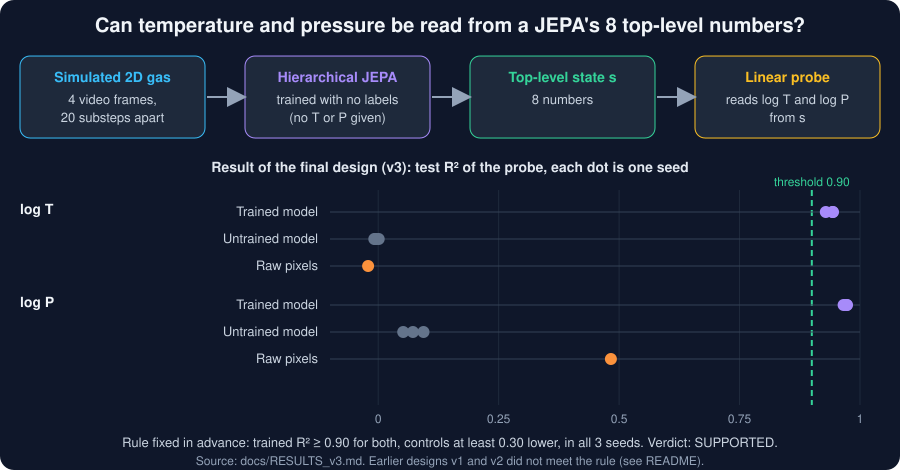

# Law-JEPA: do T and P emerge in a JEPA's top-level state?

**Question:** train a hierarchical JEPA on video of a simulated gas, with no labels. Is `log T` and `log P` of the gas linearly readable from the network's 8-number top-level state `s`?

**Result (2D gas): SUPPORTED with the third design (v3).** Trained-model probe R² is 0.929-0.944 for `log T` and 0.966-0.973 for `log P` in all 3 seeds. Designs v1 and v2 did not meet the rule. **3D gas: planned and pre-registered, not started.**



## Decision rule (fixed before any result)

Supported only if, in all 3 seeds, test R² is at least 0.90 for `log T` and `log P`, and both controls (raw-pixel probe, untrained-model probe) score at least 0.30 lower.

## Result by design (2D)

| Design | Clip | Motion losses | `log T` R² | `log P` R² | Verdict |
| --- | --- | --- | --- | --- | --- |
| v1 | 2 frames, 80 substeps apart | none | 0.00 or below at every layer | about 0.53 | Not supported |
| v2 | 2 frames, 20 substeps apart | patch and head-on-`s` | 0.78-0.80 | 0.90 | Not supported (`log T` too low) |
| **v3** | **4 frames, 20 substeps apart** | **patch and head-on-`s`** | **0.929-0.944** | **0.966-0.973** | **Supported** |

Controls in v3: raw pixels `log T` -0.021, `log P` 0.483. Untrained model `log T` at most 0.001, `log P` at most 0.094. The closest margin is `log T` in seed 0 (0.929). Supported only for this simulator and the 4-frame, 20-substep input.

## Status by category

| Category | Done | Pending (planned) | Not planned (gap) |
| --- | --- | --- | --- |
| **1. Simulator, 2D** | `src/sim/gas.py`. Check passed: P·A/(N·T) within 3% of 1+2φ on 3 cases, energy drift below 2% | - | - |
| **2. Dataset, 2D** | 1000/100/100 episodes of 300 frames (v1, v2); v3 data from `gen_dataset.py` with `--pre_gap 20 --n_pre 3` | - | Datasets (about 0.5 GB) are not stored; they must be regenerated |
| **3. Model and training** | Hierarchical JEPA. v1 and v3: 3 seeds x 60,000 steps (v2: step count not stated in the docs). v3 ran at 0.058 s/step with no collapse or NaN | - | Checkpoints (about 118 MB) are in plain git; the old README recommends Git LFS or a release |
| **4. Controls** | Raw-pixel ridge probe and untrained-model probe, for all three designs | - | No non-hierarchical (single-level) JEPA baseline found in the docs or results, so the effect of the hierarchy is untested |
| **5. Decision and write-up** | Rule applied (ledger entry 21); `docs/RESULTS_v3.md`; `docs/EXPERIMENT_REPORT.md` covers v1 to v3 | - | `PLAN.md` step 6 promised a figure of predicted vs true `log T` and `log P` on test; `results/` holds JSON only |
| **6. Reproducibility** | `env/requirements.txt`, `scripts/run_v3.sh`, hash-chained ledger (`python ledger.py verify`), MIT `LICENSE` | - | `run_v3.sh` hard-codes `/root/gas` and `/venv/main/bin/python`; only one test file (`src/tests/check_sim.py`); no CI |
| **7. 3D gas** | Step 0 only: `docs/DESIGN_3D.md` and `docs/PLAN_3D.md` frozen and ledgered (entry 23, 2026-11-14) | Steps 1-7 of `PLAN_3D.md`: 3D simulator and its check, 3D dataset, feasibility check and controls, training of arm A (3 seeds), probes and decision, optional exploratory arm B, write-up | `src/sim/gas3d.py` and `src/tests/check_sim3d.py` do not exist yet |
| **8. Beyond the current question** | - | - | Out of scope in `PLAN.md`: interventions, horizon, transportability. Not mentioned anywhere: more than 3 seeds, other simulators |

## Reproduce v3

```bash
pip install -r env/requirements.txt
cd src && bash ../scripts/run_v3.sh
python probes.py --mode final --data data3 --runs runs --runtag _v3 --tag _v3
python supervisor.py decide _v3
```

Tested on Python 3.12.15 with an RTX 4090 (`env/instance_info.txt`). `run_v3.sh` assumes the paths noted above.

## Files

| Path | Purpose |
| --- | --- |
| `src/sim/gas.py` | 2D hard-disk gas simulator |
| `src/gen_dataset.py`, `src/data.py` | Clip generation and loading |
| `src/model.py`, `src/train.py` | Hierarchical JEPA and training |
| `src/probes.py`, `src/supervisor.py` | Linear probes, controls, decision rule |
| `src/diag_*.py`, `src/mech.py` | Diagnostics (frame spacing, clip length, hand features) |
| `src/ledger.py`, `src/ledger/ledger.jsonl` | Hash-chained log of every step |
| `docs/` | `PLAN.md`, `SUPERVISOR.md`, `RESULTS_v3.md`, `EXPERIMENT_REPORT.md`, `DESIGN_3D.md`, `PLAN_3D.md` |
| `results/` | Probe, control and diagnostic JSON for v1, v2, v3 |
| `checkpoints/`, `logs/`, `env/` | Trained weights, run logs, environment record |

## License

MIT. See `LICENSE`.
